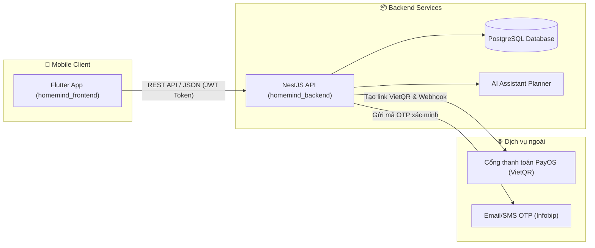

# 🏠 Welcome to HomeMind Organization

<div align="center">
  <h3>✨ Trợ lý gia đình nhỏ — Quản lý tủ đồ & thực phẩm thông minh bằng AI ✨</h3>
  <p>Dự án môn học PRM393 — Đại học FPT</p>

  <p>
    
    
    
    
    
    
  </p>
</div>

---

## 🎯 Về Dự Án HomeMind

**HomeMind** giải quyết 3 bài toán lớn của các gia đình Việt:
1. **Gánh nặng nhận thức:** Phải ghi nhớ hàng trăm món đồ ăn, gia vị, đồ gia dụng trong nhà.
2. **Lãng phí thực phẩm:** Đồ dùng hết hạn bị lãng quên (trung bình gây lãng phí 123.000₫/tháng/hộ gia đình).
3. **Rào cản nhập liệu:** Việc gõ tay từng sản phẩm mất 30–60 giây khiến người dùng dễ nản lòng.

👉 **Giải pháp:** HomeMind ứng dụng **AI Voice Processing** tiếng Việt cho phép nhập liệu bằng giọng nói chỉ trong **<5 giây**, tự động cảnh báo đồ cận date và tự động tạo danh sách đi chợ thông minh.

---

## 🗺️ Hệ Thống Repositories

Hệ thống được module hóa thành các repository độc lập:

| Repository | Vai trò | Công nghệ chính | Trạng thái |
|---|---|---|:---:|
| 📱 [**homemind_frontend**](https://github.com/PRM392-HOMEMIND/homemind_frontend) | Ứng dụng di động (Android & iOS) | Flutter, Dart, Feature-First Architecture | [](https://github.com/PRM392-HOMEMIND/homemind_frontend) |
| 📦 [**homemind_backend**](https://github.com/PRM392-HOMEMIND/homemind_backend) | Máy chủ API, Xử lý giao dịch & Logic AI | NestJS, TypeScript, PostgreSQL, Prisma, PayOS | [](https://github.com/PRM392-HOMEMIND/homemind_backend) |
| 📚 [**documents**](https://github.com/PRM392-HOMEMIND/documents) | Đặc tả SRS, Sơ đồ ERD, Hợp đồng API, Sổ tay vận hành | Markdown, OpenAPI Specification | [](https://github.com/PRM392-HOMEMIND/documents) |
| 🌐 [**.github**](https://github.com/PRM392-HOMEMIND/.github) | Cấu hình & Hồ sơ chào mừng của Organization | GitHub Community Profile | [](https://github.com/PRM392-HOMEMIND/.github) |

---

## 🏗️ Kiến Trúc Tổng Quan (Architecture Overview)



---

## 🧭 Hướng Dẫn Dành Cho Developer Mới (Quick Onboarding)

### 1. Chuẩn bị môi trường làm việc
* Cài đặt **Node.js LTS** (>= 20.x), **Flutter SDK** (>= 3.24.x) và **PostgreSQL** (hoặc Docker Desktop).
* Tham khảo tài liệu thiết lập chi tiết tại [DEVELOPMENT_SETUP_WINDOWS_ANDROID_POSTGRESQL_VI.md](https://github.com/PRM392-HOMEMIND/documents/blob/main/setup_and_ops/DEVELOPMENT_SETUP_WINDOWS_ANDROID_POSTGRESQL_VI.md).

### 2. Luồng phát triển khuyến nghị
1. **Khởi chạy Backend trước:**
   * Clone `homemind_backend`
   * Chạy `npm install && npx prisma generate`
   * Khởi chạy PostgreSQL và chạy `npx prisma migrate deploy && npm run db:demo:seed`
   * Chạy server: `npm run start:dev` (chạy trên cổng `3000`).
2. **Khởi chạy Frontend kết nối Backend:**
   * Clone `homemind_frontend`
   * Chạy `flutter pub get`
   * Khởi chạy app kết nối tới backend local:
     ```bash
     flutter run --dart-define=BACKEND_BASE_URL=http://10.0.2.2:3000
     ```

### 3. Quy chuẩn đóng góp mã nguồn (Contribution Guidelines)
* Luôn tạo nhánh mới từ `main` theo quy tắc: `feature/<ten-tinh-nang>` hoặc `fix/<ten-loi>`.
* Kiểm tra typecheck và test trước khi tạo Pull Request:
  * Backend: `npm run typecheck && npm test`
  * Frontend: `flutter test`
* Đảm bảo không commit các file chứa secret cá nhân (`.env`, private keys).

---

<div align="center">
  <sub>HomeMind Project © 2026 Đại học FPT — All rights reserved.</sub>
</div>
